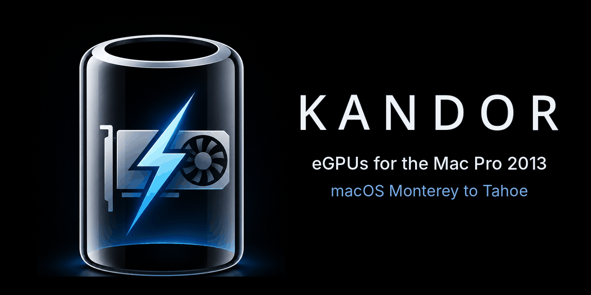

<p align="center"></p>

# Kandor - a whole new world in the cylinder

**External Graphic Cards for the Mac Pro 2013 "Trash Can".**

Kandor gets an external AMD graphics card working on the Mac Pro 2013 from macOS Monterey to Tahoe and the internal
FirePro GPUs keep working as before. It is built on the Monterey project "[Kryptonite](https://github.com/mayankk2308/kryptonite)" and,
like Superman's city in a bottle "Kandor", it is a whole new world in the cylinder.

For more info and help:

- 💬 [Join the JessiesFlying Discord server](https://discord.gg/rAhpJNqaKS)
- ▶️ [Subscribe to JessiesFlying on YouTube](https://youtube.com/JessiesFlying)

## 🧰 What you need

- A **Mac Pro (Late 2013)** running macOS Monterey (12), Ventura (13), Sonoma (14), Sequoia (15) or Tahoe (26) –
  which card works on which macOS: [macOS support](#-macos-support)
- A monitor on the Mac Pro's own ports (HDMI, or a Thunderbolt port with a Mini DisplayPort cable). You need it until
  Kandor is set up, and it's the only screen that shows the OpenCore boot menu and the Apple logo: the eGPU monitors
  only turn on at the login screen.
- A Thunderbolt 2 cable and the original **Apple Thunderbolt 2 to Thunderbolt 3 (USB-C) Adapter** (not a third-party one)
- A **Thunderbolt 3 eGPU box**
- A supported **AMD graphics card** (table below)

> [!TIP]
> Not every eGPU box gets along with the Mac Pro. Before you buy one, check [egpu.io](https://egpu.io) for boxes
> that others have used successfully with Thunderbolt 2 Macs. Kandor was tested with a Razer Core X Chroma and an
> Akitio Node Titan.

## 🎮 Graphics cards

| | Cards | AMD family |
|---|---|---|
| ✅ **Tested** | Radeon RX Vega 56 · Radeon RX 580 · Radeon RX 6900 XT (Tahoe) | Vega · Polaris · Navi (RDNA 2) |
| 🟢 **Should work** (same drivers) | RX Vega 64 · Vega Frontier Edition · Radeon Pro WX 9100 · Radeon VII · RX 460 · RX 470 · RX 480 · RX 560 · RX 570 · RX 590 · Radeon Pro WX 4100 / 5100 / 7100 · R9 280X / 290 / 380 / 390 / Fury / Nano · RX 6800 · RX 6800 XT | Vega · Polaris · older GCN · Navi (RDNA 2) |
| 🟡 **Might work** | RX 5500 / 5600 / 5700 (XT) · RX 6600 (XT) | Navi (RDNA 1 and 2) |
| ❌ **Not supported** | RX 540 / 550 (most of them) · RX 580 2048SP · RX 590 GME · RX 6950 XT · RX 6900 XT "XTXH" models · RX 6650 XT · RX 6700 / 6750 XT · RX 6400 / 6500 XT · all RX 7000 and RX 9000 · NVIDIA · Intel Arc | Polaris · Navi (RDNA 2) · RDNA 3 and 4 · other brands |

> [!NOTE]
> **Navi cards: Monterey and Tahoe only** – see [macOS support](#-macos-support).

## 🍎 macOS support

| | Monterey (12) | Ventura (13) | Sonoma (14) | Sequoia (15) | Tahoe (26) |
|---|---|---|---|---|---|
| **Polaris · Vega · older GCN** | ✅ | ✅ | ✅ | ✅ | ✅ |
| **Navi** (RX 5000 / 6000) | ✅ | ❌ | ❌ | ❌ | ✅ |

- **OpenCore Legacy Patcher (OCLP):** Monterey needs only OpenCore (step 0). Ventura to Sequoia: OCLP's root patch
  (step 3). Tahoe: OCLP **3.0.0-rc.5 or newer** – a pre-release, so download it from
  [OCLP's releases page](https://github.com/dortania/OpenCore-Legacy-Patcher/releases), not "latest" – plus Kandor's
  graphics fix (step 3a).
- **Navi on Ventura, Sonoma and Sequoia is not supported.** OCLP 3.0 offers its "AMD Navi" root patch there too, but
  Kandor's Navi fixes only act on Tahoe, and that combination is untested.
- **Tested with this release:** RX 6900 XT on Tahoe 26.7.3 · RX Vega 56 on Tahoe 26.7.2 and Monterey 12.7.6.
  Polaris and Vega on Ventura, Sonoma and Sequoia were tested with the previous build; Navi on Monterey with an
  earlier Kryptonite build.

## 🚀 Setup

> [!IMPORTANT]
> **Always switch the eGPU box on first, then the Mac.** Never plug in, unplug or switch on the eGPU while the Mac
> starts up or runs. To change something, shut the Mac down first. Don't use "Disconnect" in the menu bar either.
> Unplugging while the Mac runs logs you out after a few minutes (unsaved work is lost); "Disconnect" crashes the
> Mac. Either way the eGPU stays gone until a restart.

### 0. Monterey only: install OpenCore

Monterey runs on the Mac Pro without [OpenCore Legacy Patcher](https://dortania.github.io/OpenCore-Legacy-Patcher/) (OCLP). If OpenCore isn't installed yet, click **Build and Install OpenCore** in
OCLP first. On Ventura and later it's needed to run macOS anyway.

### 1. Install Kandor

On **Tahoe with a Vega or Navi card**, first install Apple's Command Line Tools:

```
xcode-select --install
```

Download the **Kandor zip file** from the [latest release](https://github.com/JessiesFlying/Kandor/releases/latest) and unzip
it (for example in Downloads). Open Terminal, go into the folder and start the Kandor menu:

```
cd ~/Downloads/Kandor
sudo bash kandor.sh
```

Then choose menu option **#3: "efi"**. It asks before it changes anything and keeps a backup of your EFI. If a step
of the EFI update fails, it puts the EFI back as it was.

> [!NOTE]
> "efi" also adds one kernel patch to OpenCore: OCLP's "Disable Library Validation Enforcement", so macOS Tahoe can
> load Kandor's graphics fix. It is only active on Tahoe and stays in the EFI on the other macOS versions (all
> macOS on the Mac start from the same EFI). Menu option **#5: "shim-patch-revert"** doesn't remove it either.

### 2. Shut down and attach the eGPU

Shut down the Mac, connect the eGPU to one of the **two lower Thunderbolt ports** (the pair next to HDMI), switch the
box on, then start the Mac.

> [!WARNING]
> The upper Thunderbolt ports don't work for the eGPU: with the eGPU there, the Mac doesn't start (no chime).

> [!IMPORTANT]
> **Tahoe with a Navi card:** the Navi card shows no picture until step 3a is done and the Mac has restarted – use
> the monitor on the Mac Pro's own ports until then.

### 3. Install the graphic drivers

Skip this step on Monterey.

In OCLP, click **Post-Install Root Patch** with the eGPU attached. Open OCLP yourself – it doesn't prompt for a new
card. It lists every patch for this Mac, also those already installed: just click **Start Root Patching**. If OCLP says the system is already patched, click
**Revert Root Patches** first, restart and try again. When OCLP has finished, restart – except on **Tahoe with a
Vega or Navi card**: there **don't restart yet** and go on with step 3a.

### 3a. Tahoe with a Vega or Navi card only

Start the Kandor menu and choose menu option **#4: "shim-patch"**, then restart. The eGPU stays attached.

### 4. Check

```
sudo bash kandor.sh
```

Start the Kandor menu and choose menu option **#1: "status"**. Every line should show a green ✓. 🎉

## 🔁 What to do after updating macOS or OCLP

| After … | do this |
|---|---|
| OCLP **Build and Install OpenCore** | menu option **#3: "efi"** again |
| a macOS update | on Monterey to Sequoia: nothing (OCLP offers its root patch again – install it as in step 3). On **Tahoe with a Vega or Navi card**: in OCLP **Post-Install Root Patch**, **don't restart**, menu option **#4: "shim-patch"**, then restart – as in steps 3 and 3a. With a Navi card the eGPU shows no picture until that is done: use a monitor on the Mac's HDMI port |
| an OCLP root patch (again, or after an OCLP update) | nothing – except on **Tahoe with a Vega or Navi card**: menu option **#4: "shim-patch"** again before restarting |

## 📋 Menu

| | |
|---|---|
| **#0: "credits"** | who made what, license |
| **#1: "status"** | shows the system status, changes nothing |
| **#2: "log"** | collects error logs when something goes wrong, changes nothing |
| **#3: "efi"** | installs Kandor into OpenCore |
| **#4: "shim-patch"** | macOS Tahoe: installs the graphics fix (Vega and Navi) |
| **#5: "shim-patch-revert"** | macOS Tahoe: uninstalls the graphics fix (Vega and Navi) |

## 💡 Tips for Tahoe with a Navi card

- **Turn off system sleep:** `sudo pmset -a sleep 0` (display sleep is fine). After waking from system sleep the
  displays can become unstable.
- **Monitors at the eGPU flicker:** turn HDR off on them.
- **Empty icons in the Dock** on the eGPU monitors after a fresh install: with only the eGPU monitors connected, clear
  the icon cache once:
  ```
  sudo rm -rf /Library/Caches/com.apple.iconservices.store
  rm -rf "$(getconf DARWIN_USER_CACHE_DIR)"{com.apple.dock.iconcache,com.apple.iconservices}
  sudo launchctl kickstart -k system/com.apple.iconservices.iconservicesd; killall Dock
  ```

## 🛟 If something goes wrong

- **The Mac hangs while starting:** hold the power button until it turns off, unplug the eGPU and start the Mac
  again (or pick another macOS in the OpenCore boot menu).
- **The eGPU was unplugged or disconnected via the menu bar while the Mac was running:** the picture freezes or only the mouse
  pointer moves. Wait about 3 minutes – usually the login screen comes back (the eGPU stays off until a restart). If
  nothing changes, hold the power button until the Mac turns off. Then plug the eGPU in, switch it on and start the
  Mac.
- **No picture on the eGPU:** choose menu option **#1: "status"** – the lines marked ✗ or ! tell you what to do.
- **Still stuck:** choose menu option **#2: "log"** and send the file `kandor-log-<date>.zip` it creates in the Kandor folder when you ask for help on the
  [JessiesFlying Discord server](https://discord.gg/rAhpJNqaKS).

Kandor creates the folders `backup` and `logs` next to `kandor.sh`. They stay on your Mac – don't share `backup`.

## ❤️ Credits

Kryptonite by mayankk2308 and mac_editor (with patches by goalque and rgov) · Kryptonite for
Sequoia and Tahoe (the fork Kandor builds on) and Navi support on Tahoe by ne1rom, with assistance from Claude (Anthropic) · Kandor by JessiesFlying, with assistance from Claude (Anthropic) ·
OpenCore and Lilu by acidanthera · OpenCore Legacy Patcher by Dortania.

Who did which part: [AUTHORS](AUTHORS) · licenses: [LICENSE-NOTES.md](LICENSE-NOTES.md) · Kandor is GPL-3.0
([LICENSE](LICENSE)).
